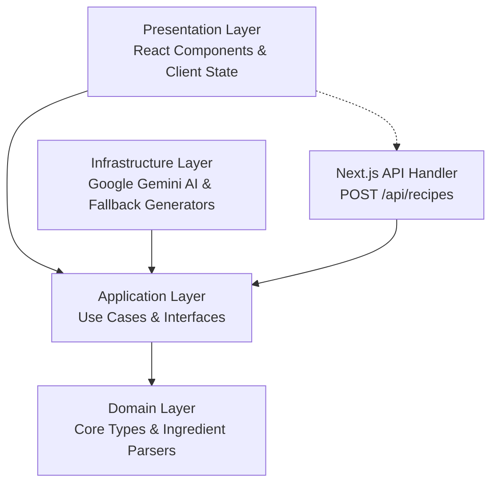

# Architecture & Module Organization

Chet-GPT is designed around **Clean Architecture** and **SOLID Principles**. This structure isolates the core business logic from external frameworks, user interfaces, database drivers, and third-party APIs (such as Google Gemini).

## Clean Architecture Layers

The code resides inside `src/features/recipes/` and is divided into four distinct, predictable layers:



---

### 1. Domain Layer (`src/features/recipes/domain/`)

The Domain layer is the most stable and inner layer. It defines our core business entities, interfaces, and immutable validation/formatting helpers. It has zero external dependencies on Next.js, React, or fetch APIs.

* **[recipe.ts](file:///c:/Users/Jerax/Desktop/my_portfolio_react/chet-gpt/src/features/recipes/domain/recipe.ts)**:
  * Defines allowed styles: `recipeStyles` (`"any"`, `"quick"`, `"family"`, `"spicy"`, `"healthy"`, `"budget"`).
  * Establishes the `RecipeSuggestion` type returned by generators (IDs, Burmese titles, cook times, difficulty levels, list of ingredients, and execution steps).
  * Outlines request payloads (`RecipeRequest` containing ingredients, style, and optional `model` ID) and execution output wraps (`RecipeResult`).
* **[ingredient-parser.ts](file:///c:/Users/Jerax/Desktop/my_portfolio_react/chet-gpt/src/features/recipes/domain/ingredient-parser.ts)**:
  * Contains the helper `parseIngredients(value: string): string[]`.
  * Splits user-provided ingredients using a regular expression separator (`/[\n,;|]+/g`).
  * Normalizes elements to lowercase, trims whitespace, removes empty entries, and filters out duplicates.

### 2. Application Layer (`src/features/recipes/application/`)

The Application layer contains use cases that orchestrate the flow of data to and from the domain entities.

* **[generate-recipes-use-case.ts](file:///c:/Users/Jerax/Desktop/my_portfolio_react/chet-gpt/src/features/recipes/application/generate-recipes-use-case.ts)**:
  * Exposes the `RecipeGenerator` interface containing the async `generate(request: RecipeRequest): Promise<RecipeResult>` command.
  * Declares `GenerateRecipesUseCase`, which handles execution validation (raising an error if no ingredients exist) and normalizes recipe style flags before delegating generation to the concrete adapter.

### 3. Infrastructure Layer (`src/features/recipes/infrastructure/`)

The Infrastructure layer implements the abstract interfaces defined in the Application layer, communicating with external systems like AI providers or local data fallbacks.

* **[google-gemini-recipe-generator.ts](file:///c:/Users/Jerax/Desktop/my_portfolio_react/chet-gpt/src/features/recipes/infrastructure/google-gemini-recipe-generator.ts)**:
  * Adapter utilizing the modern `@google/genai` client.
  * Implements `RecipeGenerator`.
  * Accepts dynamic AI model configuration parameter overrides inside both its constructor and request payload to target different Gemini models.
  * Integrates a strict 25-second timeout via `Promise.race` to prevent hanging network calls.
* **[recipe-ai-output.ts](file:///c:/Users/Jerax/Desktop/my_portfolio_react/chet-gpt/src/features/recipes/infrastructure/recipe-ai-output.ts)**:
  * Assembles system/user prompts instructing Gemini to respond strictly in a valid JSON schema with all user-facing strings translated to Burmese.
  * Sanitizes, parses, and formats outputs (capping text lengths, clipping lists, bounding cook times between 5 and 240 minutes, and fallback-mapping difficulty attributes).
* **[local-recipe-generator.ts](file:///c:/Users/Jerax/Desktop/my_portfolio_react/chet-gpt/src/features/recipes/infrastructure/local-recipe-generator.ts)**:
  * Implements an offline `RecipeGenerator` fallback.
  * Reads the primary ingredient, aggregates secondary items, and uses pre-configured Burmese recipes ("ဆီပြန်ဟင်း", "ထမင်းကြော်", "ဟင်းချို") with dynamic ingredient adjustments to return reliable suggestions.
* **[ai-request-error.ts](file:///c:/Users/Jerax/Desktop/my_portfolio_react/chet-gpt/src/features/recipes/infrastructure/ai-request-error.ts)**:
  * Catches Google Gemini network failures or timeout errors and seamlessly redirects execution to the local fallback generator while attaching a descriptive warning note.

### 4. Presentation Layer (`src/features/recipes/presentation/`)

The Presentation layer is responsible for rendering content and capturing user actions.

* **[recipe-planner.tsx](file:///c:/Users/Jerax/Desktop/my_portfolio_react/chet-gpt/src/features/recipes/presentation/recipe-planner.tsx)**:
  * Contains the interactive `RecipePlanner` client component.
  * Manages UI state: input ingredients, selected cooking style, active load indicator, HTTP error messages, fetched recipe arrays, and dynamic `models` listings with the active `selectedModel` state.
  * Dynamically consumes Axios to load target models from `public/models.json` on initialization.
  * Uses utility sub-components: `AppHeader`, `HeroPanel`, `IngredientPanel`, `SelectedIngredients`, `ResultsSection`, and `RecipeCard`.

---

## The Dependency Rule

```text
  [ Presentation ]   -->   [ Application ]   -->   [ Domain ]
           ^                       ^
           |                       |
  [  API Route   ]         [ Infrastructure ]
```

* Outer layers can import from inner layers, but inner layers must **never** reference outer layers.
* For example, **Domain** never references `GenerateRecipesUseCase` or `fetch`.
* **Application** only references the abstract interface `RecipeGenerator` and types in **Domain**. It knows nothing about Google Gemini or local generators.
* This makes the core business rules extremely reusable, simple to unit-test, and decoupled from framework details.
